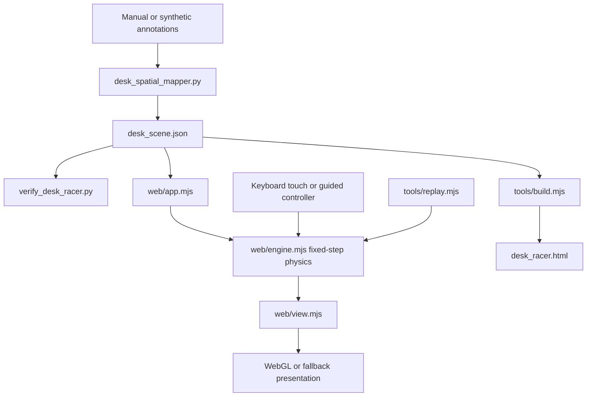
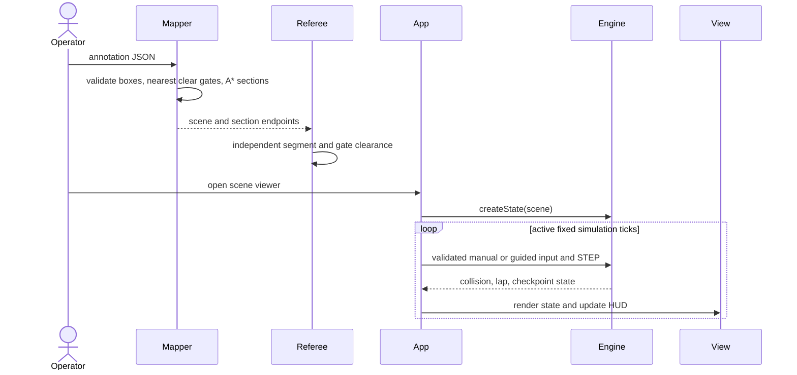

# Desk circuit racer architecture

Reviewed against the local working tree on 2026-11-07. Source paths below are relative to this repository.

## System context and data flow

Manual top-down annotations become a nominal-centimetre desk scene. Python places clear checkpoints and connects them with A*. A separate referee checks the continuous route. The browser consumes the scene and runs fixed-step car physics with manual or guided input. The project does not infer metric geometry from photographs.



## Main execution sequence



## Modules and ownership

- `desk_spatial_mapper.py` validates annotation provenance/boxes, maps normalized coordinates, places six checkpoints, and builds routes.
- `verify_desk_racer.py` implements an independent interval-intersection referee and validates the route, car envelope, and gate disks.
- `web/engine.mjs` owns collision sweeps, car state, ordered checkpoint/lap progression, guided steering, and a 120 Hz fixed clock.
- `web/app.mjs` owns controls, pause/restart, visibility handling, scene loading, and scheduling. `web/view.mjs` owns rendering and camera resources.
- `tools/build.mjs` builds standalone output. `tools/replay.mjs` replays the guided controller without a browser. Python and Node tests cover both pipeline and physics.

## State and failure handling

The scene is a JSON snapshot. Runtime car state is mutable in the engine and contains position, speed, angle, lap timer, next checkpoint, impact debounce, and guided waypoint. `FixedClock` accumulates frame time and clamps a frame to 0.25 seconds. Pause/visibility resets the clock and controls. Swept collisions prevent tunnelling through obstacles between endpoints. Only the expected checkpoint can advance lap state. Guided completion stops simulation after a full lap. Rendering has its own dirty-frame budget and does not define physics time.

## Reproduce the checks

```sh
python -m pytest -q
node --test tests/*.test.mjs
```

The new Python tests exercise an independent nearest-cell oracle, obstacle-detour route properties, real CLI-to-referee output, and preservation of existing output on rejected input. Browser rendering and device input require separate browser checks.
