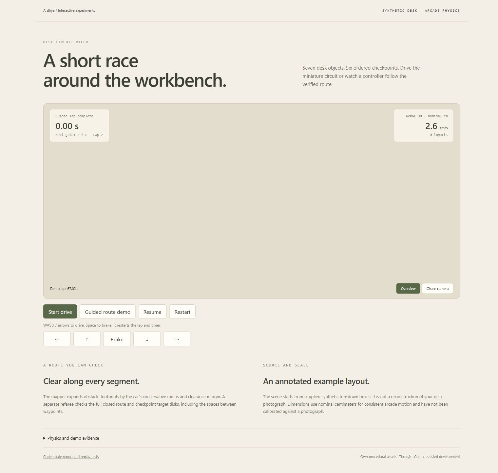

# Desk Circuit Racer

[](https://github.com/vanovri/desk-circuit-racer/actions/workflows/verify.yml)

A small WebGL desk-racing game with own procedural assets, a real clearance-checked
route, fixed-step arcade motion, swept collision, six ordered gates, keyboard/touch
controls, and a deterministic guided controller that drives through the same model.



## Try it

`desk_racer.html` is the self-contained build: Three.js, styles and the synthetic
scene are embedded. It needs no external runtime assets or Python server. The
source development version uses a normal local HTTP server:

```sh
npm ci --ignore-scripts
python -m http.server 8768 --bind 127.0.0.1
# Open http://127.0.0.1:8768/
```

WASD/arrows drive, Space brakes, R restarts the lap and timer. On-screen hold
buttons support touch. Choose an overview or chase camera. Losing focus pauses
the run and releases held controls. A 2D compatibility renderer is available when
WebGL cannot initialize.

The guided demo runs at 4x simulation speed and stops after one lap. It controls
steering, throttle and braking without teleporting the car. Demo lap timing is
separate from the manual-drive run. The arcade car can turn while stationary.

## Rebuild and verify

Python 3.10+, Node 20+ (CI uses 22). Three.js and esbuild versions are locked.

```sh
python desk_spatial_mapper.py
python verify_desk_racer.py
python -m unittest discover -s tests -v
npm test
node tools/replay.mjs
node tools/build.mjs
```

The mapper generates a route using A* on a one-centimeter grid. It checks every
candidate segment against expanded obstacle footprints and refuses an obstructed
layout. The independent referee checks every final segment, guarded tabletop
bounds, complete gate disks, gate spacing, route closure and ordered section ends.
Free checkpoint centers alone do not establish a traversable course.

The committed example has seven objects, six gates, 55 waypoints and a 549.137 cm
centerline. The model replay completes a lap in 8,043 fixed ticks, approximately
67.025 simulated seconds, with zero impacts. See [route report](reports/route.json)
and [actual controller trace](reports/guided-replay.json).

Tests cover swept collision through a thin obstacle, tabletop margins, display-frame
partition independence, pause/invalid input, gate-order enforcement, full controlled
lap completion, restart/long-frame limits, malformed annotations, blocked layouts,
independent route rejection and standalone HTML structure/syntax.

## Source and measurement limits

The scene adapts supplied synthetic top-down bounding boxes. It is not an actual
reconstruction of the user's desk or a vision-model result. `examples/detections.json`
records that provenance. Manual top-down annotations can be supplied to the mapper,
but perspective photograph boxes cannot be converted into calibrated dimensions
by this linear mapping. Height values come from an illustrative category catalog.

Lengths and motion share nominal centimeters; speed is displayed directly in cm/s.
No arbitrary km/h multiplier is used. Motion runs at 120 fixed simulation steps
per second. The clock measures active simulated time; long display stalls are
clamped and focus loss pauses the run. Car and obstacle envelopes are conservative,
not a calibrated RC-car dynamics model.

Actual browser QA confirmed WebGL rendering, a completed zero-impact guided lap,
positive keyboard and touch throttle, restart, and a narrow layout without page
overflow. See [browser evidence](docs/browser-qa.json). Interaction testing used
the development HTTP page. Browser automation disallowed the file URL, so the
self-contained file received structure, embedded-scene, script-syntax and model
checks rather than a direct file-protocol UI claim.

## Provenance and license

Own procedural desk, car and electronics geometry, generated wood texture and
synthetic layout. Developed with Codex assistance from the supplied Desk Racer
brief and earlier Desk Circuit Racer idea. No Gemini execution, automatic photo
inference, or Google benchmark result is claimed.

Project code is MIT licensed. Three.js is MIT licensed; its notice is retained in
the standalone HTML. esbuild is a build dependency with its package license. The
source release includes the standalone HTML, scene, reports, tests, and sources.
